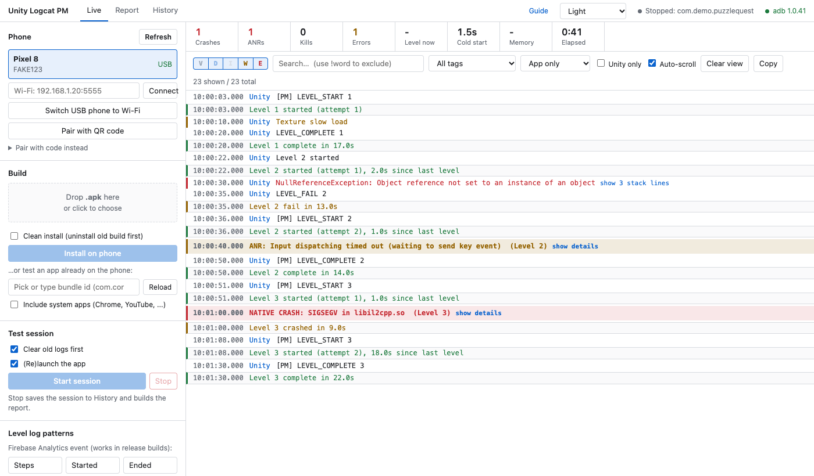
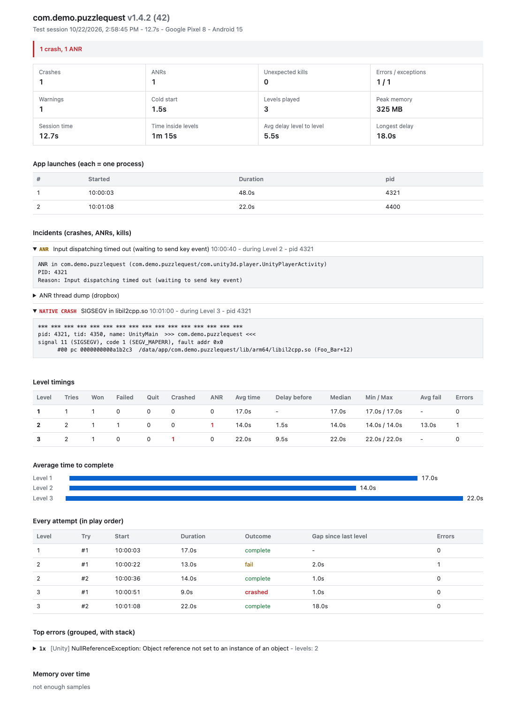

<div align="center">

# Unity Logcat PM

**Test a Unity Android build on a real phone.<br>Get crashes, ANRs and level times in one report.**

No command line. No Android Studio. Drop an APK, play, send the report.




</div>

## Why

A developer sends you a build. You play it. Something breaks, but you have no logs, no stack trace and no idea which level it happened on.

With this tool you see it as it happens, and you hand the developer proof:

| You get | Example |
|---|---|
| **Crashes** | `SIGSEGV in libil2cpp.so` during Level 3, with the backtrace |
| **ANRs** | `Input dispatching timed out` during Level 2 |
| **Level times** | Level 3 takes 22s on average, 9s of delay before it |
| **Session time** | App launches, how long each lasted, time inside levels |
| **Errors with stacks** | Same errors grouped, with the C# stack |

<div align="center">

</div>

## Start in 3 steps (Mac)

1. Unzip and double-click **Unity Logcat PM.app**.
2. Wait about a minute the first time (it fetches `adb`). The tool opens in your browser.
3. Follow the **Get started** checklist on screen.

> macOS says "unidentified developer"? Right-click the app → **Open** → **Open**.
> Newer macOS: System Settings → Privacy & Security → **Open Anyway**. One time only.

Stuck? Click **Guide** in the tool's header. It is short and has pictures.

## How it works

| | |
|---|---|
| **1. Phone** | Turn on Developer options → USB debugging and Wireless debugging |
| **2. Connect** | **Pair with QR code**, a pairing code, or a USB cable |
| **3. Build** | Drop the `.apk` and press **Install**, or pick any app already on the phone |
| **4. Play** | **Start session**, play, press **Stop** |
| **5. Report** | **Report** tab → **Download HTML** or **Copy summary** for Slack |

## Level times

The game has to log when a level starts and ends. Pick one:

- **Firebase event** (for example `Steps` with `Started` / `Ended`): type the names in the sidebar, press **Use this Firebase event**.
- **Plain logs:** add [`unity/PMLog.cs`](unity/PMLog.cs) and call `PMLog.LevelStart(id)`, `PMLog.LevelComplete(id)`, `PMLog.LevelFail(id)`.
- **Anything else:** edit the patterns (regex) in the sidebar.

For developers: set Unity → Player → **Stack Trace Logging** to `ScriptOnly` to get C# stacks.

## Run from source

Needs Node.js 18+. No `npm install`.

```bash
./start.command        # or: node server.js   → http://localhost:7878
npm test               # parser and analyzer tests
./make-app.sh          # builds dist/Unity Logcat PM.app and a zip
```

```
server.js          local web server
lib/adb.js         talks to the phone
lib/analyzer.js    finds crashes, ANRs and levels
lib/report.js      builds the HTML report
public/            the UI and the guide
unity/PMLog.cs     helper for developers
```

## Good to know

- `.apk` only (not `.aab`). One live session at a time. Tested on macOS; Windows is not supported yet.
- Runs only on your Mac (`127.0.0.1`). Other websites cannot control it.
- Sessions hold raw device logs and are saved on your Mac (`~/Library/Application Support/UnityLogcatPM` for the app, `./sessions` from source). Delete them in the **History** tab if needed.
- ANR thread dumps are not available on every phone.
